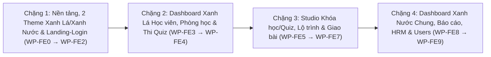

# Kế Hoạch Thiết Kế & Xây Dựng Frontend – Corporate LMS NovaTech (DT02)

> **Dự án:** Hệ thống Quản lý Đào tạo Nội bộ & Đánh giá Năng lực – NovaTech Solutions (`DT02`)  
> **Trạng thái Backend:** Đã hoàn thiện 100% (`WP0 → WP14`, CRUD Quiz/Câu hỏi trắc nghiệm, dọn sạch API trùng lặp, phân quyền RBAC & toàn quyền tối cao cho `ADMIN`).  
> **Mục tiêu tài liệu:** Hợp nhất **Chuẩn ngôn ngữ thiết kế & bố cục giao diện (Clean Enterprise SaaS UI)** với **Lộ trình triển khai kỹ thuật chi tiết (`WP-FE0 → WP-FE9`)**, bám sát 100% hợp đồng dữ liệu thực tế tại [guideAPI.md](file:///c:/Code/Enterprise-Learning-Management-System---LMS/backend/guideAPI.md).

---

## 1. Ngôn Ngữ Thiết Kế, Bố Cục & Quy Chuẩn Thẩm Mỹ (UI/UX Specification)

### 1.1. Định hướng tổng thể — Clean Enterprise SaaS UI
- **Phong cách kết hợp:**
  - **Minimalist / Flat UI:** Màu phẳng, ít trang trí, gần như không dùng đổ bóng; ưu tiên phân lớp bằng sắc độ nền nhạt, đường viền mảnh (`1px`) và khoảng trắng.
  - **Card-based Dashboard:** Chia nội dung thành thẻ chức năng, bảng dữ liệu và các khối thống kê gọn gàng.
  - **Typography-led Hierarchy:** Phân cấp bằng cỡ chữ, độ đậm (`weight`), khoảng trắng và căn chỉnh chặt chẽ thay vì hiệu ứng.
  - **Muted Color Palette:** Nền sáng dịu mắt, bảng màu trung tính êm ái và một màu nhấn điềm tĩnh cho từng không gian vai trò.

### 1.2. Sự phân hóa rõ rệt giữa 3 điểm chạm giao diện chính

Hệ thống tuân thủ chung quy chuẩn phẳng, tinh gọn và kiểu chữ `Inter`, nhưng phân định **sắc thái màu & bố cục đặc trưng** cho từng đối tượng:

| Khu vực / Vai trò | Định hướng bố cục & Cảm xúc thị giác | Bảng màu chuẩn (Muted & Calm Palette) |
| :--- | :--- | :--- |
| **1. Trang `/login` (Mini Corporate Landing Page + Đăng nhập)** | **Không làm trang đăng nhập trống đơn điệu.** Thiết kế thành một **Mini Landing Page cổng đào tạo nội bộ NovaTech** chỉn chu: Header thương hiệu, khu vực Hero 2 cột tích hợp ngay khung Đăng nhập & Quick Demo Switcher ở màn hình đầu tiên, nối tiếp bên dưới là các khối giới thiệu 3 trụ cột đào tạo (`BR-01..03`), khung tiêu chuẩn 5 cấp bậc (`INTERN → LEAD`) và chân trang kèm trạng thái hệ thống live (`GET /health`). | • Nền tổng thể trắng ngà điểm xuyết dải nền xanh lá nhạt (`#F4F8F6`) & xanh nước nhạt (`#F2F7FB`)<br>• Thẻ trắng tinh `#FFFFFF`, viền mảnh `#E2E8F0`<br>• Nút chính & nhận diện thương hiệu NovaTech: `#176552` |
| **2. Không gian Học viên (`EMPLOYEE`) — *Không dùng Sidebar, điều hướng bằng Tab ngang trên Header*** | **Loại bỏ hoàn toàn thanh Sidebar bên trái.** Sử dụng Header trắng tinh gọn tích hợp logo chữ **`nova / learn`**, 3 nút chọn chuyển Tab ngang (*Góc học tập*, *Lộ trình của tôi*, *Năng lực cá nhân*), chuông thông báo và menu người dùng. Dashboard gồm thẻ xanh lá đậm `#155746` hiển thị bài học tiếp theo + `% hoàn thành`, thẻ Onboarding nền đá ấm `#EFF2EC`, danh sách 5 chặng `01..05` và thẻ Sắp đến hạn. | • **Nền trang (Canvas):** Trắng ngà ấm dịu mắt (`#F7F8F5`)<br>• **Thẻ Hero bài học tiếp theo:** Xanh lá rừng trầm (`#155746` / `#176552`), nút trắng nổi bật<br>• **Thẻ Onboarding phụ:** Xám đá ấm (`#EFF2EC`), viền `#E2E7DF`<br>• **Logo:** Wordmark **`nova / learn`** |
| **3. Không gian Quản trị chung (`ADMIN`, `HR`, `TRAINER`) — *Đồng nhất sắc Xanh Nước Nhẹ Nhàng*** | **Dùng chung một cấu trúc Dashboard điều hành & hệ thống quản trị thống nhất** cho cả 3 vai trò (chỉ biến thiên chỉ số KPI và quyền thao tác theo Role). Bố cục lưới thẻ thống kê, biểu đồ phẳng và bảng dữ liệu thoáng, sáng sủa, dễ nhìn khi làm việc nhiều giờ liên tục (không dùng mảng màu tối nặng nề). | • **Nền trang (Canvas):** Trắng xám pha xanh nước rất nhạt (`#F4F8FB`)<br>• **Sidebar & Bề mặt phụ:** Xanh nước nhạt dịu mắt (`#EAF3FA` / `#F0F6FC`), viền `#D4E3F0`<br>• **Thẻ nội dung:** Trắng `#FFFFFF`<br>• **Màu nhấn chính (CTA, tab chọn, biểu đồ):** Xanh nước điềm tĩnh `#1B6CA8` / `#0284C7` |

### 1.3. Quy chuẩn Bố cục (Layout & Spacing)
- **Khung chuẩn Desktop:** Thiết kế rộng chuẩn `1440 px`, bố cục lưới căn chỉnh chặt chẽ, tự động co giãn mượt xuống Laptop và Mobile Drawer.
- **Hệ khoảng cách (4/8-pt Grid):**
  - Padding vùng nội dung chính: `32–40 px` trên Desktop (`20–24 px` trên màn hình nhỏ).
  - Khoảng cách giữa các khối/thẻ (`gap`): `20–24 px`.
  - Mọi khoảng cách nội bộ dùng bội số của `4 px` hoặc `8 px`.
- **Đầu trang (`PageHeader`):** Tiêu đề trang + mô tả ngắn 1 dòng + **tối đa 01 hành động chính nổi bật (Primary CTA)** ở góc phải.

### 1.4. Typography, Thành phần & Nguyên tắc loại trừ
- **Typography (`Inter` hỗ trợ tiếng Việt tốt):**
  - Tiêu đề trang (`H1`): `28–32 px`, `semibold (600)`.
  - Tiêu đề khối (`H2/H3`): `16–20 px`, `semibold (600)`.
  - Nội dung chính (`Body`): `14–16 px`, chữ chính màu than đậm ngả xanh (`#111827` / `#0F172A`), chữ phụ xám trung tính đủ tương phản (`#4B5563` / `#64748B`).
  - Metadata / Nhãn cột bảng: `12–13 px`, số liệu dùng `tabular-nums`.
- **Thành phần UI phẳng:**
  - Card, ô nhập liệu và nút bấm bo góc nhẹ `4–8 px` (`rounded-md` / `rounded-lg`), không bo tròn quá mức.
  - Nút gọn (`36–40 px`), icon nét mảnh đồng nhất (`lucide-react`, `strokeWidth={1.75}`), thanh tiến độ phẳng đơn giản.
  - Nhãn trạng thái (`Badge`) dùng nền pastel nhạt + viền mảnh + chữ rõ nghĩa (`COMPLETED/PASSED` xanh ngọc nhạt, `IN_PROGRESS/UNLOCKED` xanh nước nhạt, `LOCKED/Draft` xám/vàng nhạt kèm icon khóa, `OVERDUE/FAILED/GAP` hồng đỏ nhạt).
  - Bảng dữ liệu hàng thoáng, chỉ dùng đường kẻ ngang mảnh, căn chỉnh số liệu nhất quán.
- **Tránh tuyệt đối:**
  - Không gradient rực rỡ, neon, glassmorphism, neumorphism, hiệu ứng 3D, card bo góc quá lớn hay shadow nặng.
  - Không dùng dữ liệu giả ngầm (`silent mock fallback`); mọi màn hình đều có đủ 4 trạng thái thật: **Skeleton → Data → Empty State → Error Toast/Banner tiếng Việt**.

---

## 2. Hạ Tầng Kỹ Thuật & Quy Ước Tích Hợp Chính Xác Với Backend

| Hạng mục | Quy ước chuẩn theo [guideAPI.md](file:///c:/Code/Enterprise-Learning-Management-System---LMS/backend/guideAPI.md) | Giải pháp triển khai trong Frontend |
| :--- | :--- | :--- |
| **Cổng chạy & Base URL** | Backend mặc định chạy cổng `5000` (`CORS_ORIGINS` cho phép `http://localhost:3000`). | Cấu hình `dev` & `start` trong [package.json](file:///c:/Code/Enterprise-Learning-Management-System---LMS/frontend/package.json) chạy chuẩn ở cổng **`3000`** (`http://localhost:3000`), gọi tới `NEXT_PUBLIC_API_URL=http://localhost:5000/api/v1`. |
| **Dọn sạch mã nguồn cũ** | Repo hiện còn cả `frontend/src/*` cũ lẫn thư mục thừa `frontend/lib/` ngoài `src/`. | Trong `WP-FE0`, xóa sạch cả nội dung cũ trong `frontend/src/` và thư mục `frontend/lib/` để tránh xung đột TypeScript (`tsc --noEmit`). |
| **File nhị phân bảo mật JWT** | `GET /files/:id` (xem PDF) và `GET /reports/competency-matrix/export` (tải `.xlsx`) yêu cầu `Authorization: Bearer <token>`. | Fetch qua `apiClient` ở chế độ `Blob`, tạo `URL.createObjectURL(blob)` để nhúng trình đọc PDF hoặc tải tệp Excel an toàn (thu hồi `revokeObjectURL` khi đóng). |
| **Đổi mật khẩu tăng `tokenVersion`** | `POST /auth/change-password` tăng `tokenVersion`, vô hiệu hóa ngay JWT hiện tại. | Ngay khi đổi mật khẩu thành công, tự động gọi lại `POST /auth/login` bằng mật khẩu mới để cấp JWT mới hợp lệ (nếu lỗi thì điều hướng về `/login`). |
| **Bắt mã lỗi chuẩn Backend** | Lỗi trả về `{ statusCode, message, errorCode, details? }`. | Xử lý tập trung: `AUTH_UNAUTHORIZED` (`401`) → về `/login`; `AUTH_MUST_CHANGE_PASSWORD` (`403`) → ép về `/change-password`; `BR02_LOCK_CONSTRAINT`, `QUIZ_MAX_ATTEMPTS_REACHED`, `PATH_IN_USE`, `PATH_STRUCTURE_INVALID` (`422`) → hiển thị đúng `message` & `details` tiếng Việt. |
| **Chuẩn hóa cấu trúc trả về đặc thù** | Đa số trả `{ data[], total, page, limit, totalPages }`, nhưng một số API trả cấu trúc riêng. | Chuẩn hóa ngay tại tầng `services/*.service.ts`:<br>• `GET /learning-paths` → mảng trực tiếp `[]`<br>• `GET /users` → luôn truyền `page, limit` để nhận phân trang chuẩn<br>• `GET /notifications` → phân trang chuẩn kèm `unreadCount`<br>• `GET /hrm/employees` → đọc từ `res.mockEmployees`<br>• `POST /hrm/sync-users` → đọc từ `res.data.summary` (`totalProcessed`, `createdCount`...) & `res.data.syncedUsers`<br>• `GET /reports/competency-matrix` → đọc từ `res.data` (`skills`, `employees`, `positionSummary`, `matrix`) |

---

## 3. Kiến Trúc Thư Mục & Bộ Công Nghệ

### 3.1. Công nghệ sử dụng
- **Nền tảng sẵn có:** Next.js 16 (App Router) + React 19 + TypeScript 5 (`strict: true`) + Tailwind CSS v4.
- **Gói thư viện cài bổ sung:** `lucide-react`, `react-markdown`, `remark-gfm`, `@dnd-kit/core`, `@dnd-kit/sortable`, `@dnd-kit/utilities`.

### 3.2. Cấu trúc thư mục `frontend/src/`
```text
frontend/src/
├── app/
│   ├── (auth)/                         # Không có Sidebar quản trị
│   │   ├── login/page.tsx              # Mini Corporate Landing Page + Khung Đăng nhập & Quick Demo Switcher
│   │   └── change-password/page.tsx    # Đổi mật khẩu bắt buộc lần đầu
│   ├── (portal)/                       # Bọc AppShell tự động áp theme theo Role (Sage Green vs Soft Ocean Blue)
│   │   ├── layout.tsx
│   │   ├── dashboard/page.tsx          # EMPLOYEE: Learner Companion | ADMIN/HR/TRAINER: Unified Ocean Dashboard
│   │   ├── my-learning/page.tsx        # Lộ trình & Khóa học của tôi (EMPLOYEE)
│   │   ├── learning-paths/
│   │   │   ├── page.tsx                # Danh sách & Quản lý 5 Lộ trình (HR/ADMIN/TRAINER)
│   │   │   └── [id]/page.tsx           # Chi tiết lộ trình (Builder cho HR/ADMIN | Roadmap cho EMPLOYEE)
│   │   ├── courses/
│   │   │   ├── page.tsx                # Kho khóa học (TRAINER/ADMIN/HR/EMPLOYEE)
│   │   │   ├── [id]/page.tsx           # Phòng học đa phương tiện (VIDEO, PDF Blob, MARKDOWN + BR-02)
│   │   │   └── [id]/builder/page.tsx   # Studio biên soạn Course, Module, Lesson, PDF & Đề thi/Câu hỏi Quiz
│   │   ├── quizzes/
│   │   │   └── [id]/page.tsx           # Phòng thi trắc nghiệm + Đồng hồ + Lượt thi + Gợi ý ôn tập BR-03
│   │   ├── enrollments/page.tsx        # Giao khóa học lẻ, Giao lộ trình & Gia hạn deadline
│   │   ├── competency/page.tsx         # Ma trận năng lực động + Xuất Excel + Recalculate
│   │   ├── reports/page.tsx            # Báo cáo Tiến độ hoàn thành & Điểm bài thi Quiz
│   │   ├── hrm/page.tsx                # Đồng bộ Mock HRM, Nhật ký Sync Logs & Training Status
│   │   ├── users/page.tsx              # Quản trị Người dùng, Phân quyền & Khóa tài khoản (ADMIN)
│   │   ├── notifications/page.tsx      # Trung tâm thông báo & Quét nhắc hạn thủ công
│   │   └── profile/page.tsx            # Hồ sơ cá nhân, Đổi mật khẩu & Năng lực của tôi
│   ├── layout.tsx                      # Root Layout (Font Inter, AuthProvider, ToastProvider)
│   ├── page.tsx                        # Điều hướng thông minh (/login hoặc /dashboard)
│   └── globals.css                     # CSS Variables cho theme Learner (Sage Green) & Staff (Soft Ocean Blue)
├── components/
│   ├── layout/                         # AppShell, Sidebar, TopHeader, PageHeader, NotificationPopover
│   ├── ui/                             # Button, Input, Select, Textarea, Card, Badge, Modal, Drawer, Tabs, DataTable, ProgressBar, Skeleton, EmptyState, ConfirmDialog
│   ├── charts/                         # Biểu đồ phẳng nhẹ nhàng (HorizontalBar, ScoreDistribution, DonutSummary)
│   └── features/                       # Component nghiệp vụ (LearnerDashboardView, StaffDashboardView, CourseModuleEditor, QuizQuestionDrawer, PathValidationCard, AssignmentWizardModal...)
├── context/
│   ├── auth-context.tsx
│   └── toast-context.tsx
├── lib/
│   ├── api-client.ts
│   ├── rbac.ts
│   └── formatters.ts
├── services/                           # 10 file service khớp 1-1 với các Module trên Backend
│   ├── auth.service.ts
│   ├── users.service.ts
│   ├── courses.service.ts
│   ├── quizzes.service.ts
│   ├── learning-paths.service.ts
│   ├── enrollments.service.ts
│   ├── progress.service.ts
│   ├── notifications.service.ts
│   ├── reports.service.ts
│   └── hrm.service.ts
└── types/
    └── api.types.ts
```

---

## 4. Ma Trận Phân Quyền Giao Diện & Quy Tắc Nghiệp Vụ Theo 4 Vai Trò (`RBAC`)

| Nhóm Chức Năng & Đường Dẫn | `EMPLOYEE` *(Theme Xanh Lá Nhạt Khác Biệt)* | `TRAINER` *(Theme Xanh Nước Nhẹ Chung)* | `HR` *(Theme Xanh Nước Nhẹ Chung)* | `ADMIN` *(Theme Xanh Nước Nhẹ Chung – Toàn Quyền)* |
| :--- | :---: | :---: | :---: | :---: |
| **Tổng quan (`/dashboard`)** | **Giao diện Học viên riêng biệt** (`LearnerDashboardView` – `nextUp`, hành trình cá nhân) | **Giao diện Điều hành chung** (`StaffDashboardView` – số liệu lớp mình phụ trách) | **Giao diện Điều hành chung** (`StaffDashboardView` – số liệu toàn công ty) | **Giao diện Điều hành chung** (`StaffDashboardView` – số liệu toàn hệ thống) |
| **Học tập của tôi (`/my-learning`)** | ✅ Lộ trình + Khóa lẻ | — | — | — |
| **Phòng học & Phòng thi (`/courses/[id]`, `/quizzes/[id]`)** | ✅ Học & Thi thật (`BR-01..03`, `maxAttempts`) | 👁️ Xem trước bài giảng & đề thi | 👁️ Xem trước | 👁️ Xem trước |
| **Kho & Studio Khóa học, Quiz (`/courses`, `/courses/[id]/builder`)** | — | ✅ Chỉ sửa khóa mình tạo *(tuân thủ khóa `IN_PROGRESS`)* | 👁️ Chỉ xem kho khóa học | ✅ **Toàn quyền** *(sửa/hủy publish/xóa mọi khóa học, học phần, bài học, đề thi)* |
| **Lộ trình học tập (`/learning-paths`, `/learning-paths/[id]`)** | Xem dạng Timeline tại `/learning-paths/[id]` | 👁️ Xem & Kiểm định cấu trúc | ✅ Tạo, sửa, kéo-thả *(chỉ khóa khi có người `IN_PROGRESS`)* | ✅ **Toàn quyền** *(thêm/gỡ/sắp xếp/lưu trữ bất kỳ lúc nào)* |
| **Giao bài & Ghi danh (`/enrollments`)** | — | ✅ Chỉ giao **Khóa học lẻ** (`POST /enrollments`) & gia hạn bài mình giao | ✅ Giao **Khóa lẻ** + **Lộ trình** (`POST /assignments/path`), gia hạn, hủy giao | ✅ **Toàn quyền** *(giao mọi Khóa học & Lộ trình không bị chặn cấu trúc)* |
| **Ma trận năng lực (`/competency`)** | — *(xem cá nhân ở `/profile`)* | ✅ Học viên thuộc phạm vi giảng dạy + Xuất `.xlsx` | ✅ Toàn công ty + Xuất `.xlsx` + `Recalculate` | ✅ Toàn công ty + Xuất `.xlsx` + `Recalculate` |
| **Báo cáo đào tạo (`/reports`)** | — | ✅ Theo khóa học của mình | ✅ Toàn công ty | ✅ Toàn công ty |
| **Tích hợp HRM (`/hrm`)** | ❌ Chặn | ❌ Chặn | ✅ Đồng bộ, Sync Logs, Training Status | ✅ Toàn quyền |
| **Quản trị Người dùng (`/users`)** | ❌ Chặn | ❌ Chặn *(chỉ gọi ngầm `GET /users` rút gọn khi chọn học viên giao bài)* | ❌ Chặn | ✅ **Độc quyền** (`role` chữ hoặc `roleId`, khóa/mở khóa, xóa mềm) |
| **Thông báo & Hồ sơ (`/notifications`, `/profile`)** | ✅ | ✅ | ✅ *(có nút chạy nhắc hạn)* | ✅ *(có nút chạy nhắc hạn)* |

---

## 5. Kế Hoạch Triển Khai Chi Tiết Từng Gói Công Việc (`WP-FE0 → WP-FE9`)

### Giai đoạn 1: Nền Tảng Lõi, Design System 2 Sắc Thái & Trang Landing-Login

#### `WP-FE0` — Chuẩn Hóa Hạ Tầng, Dọn Mã Cũ & Dựng Tầng Giao Tiếp API
1. Cài đặt các gói `lucide-react`, `react-markdown`, `remark-gfm`, `@dnd-kit/core`, `@dnd-kit/sortable`, `@dnd-kit/utilities`.
2. Cập nhật [package.json](file:///c:/Code/Enterprise-Learning-Management-System---LMS/frontend/package.json) (`"dev": "next dev --webpack -p 3000"`, `"start": "next start -p 3000"`, bổ sung `"typecheck": "tsc --noEmit"`), cấu hình `next.config.ts` và tạo `.env.example` (`NEXT_PUBLIC_API_URL=http://localhost:5000/api/v1`).
3. Xóa bỏ hoàn toàn code cũ trong `frontend/src/` và thư mục thừa `frontend/lib/`.
4. Xây dựng `src/types/api.types.ts` khớp 100% tên trường Request/Response trong [guideAPI.md](file:///c:/Code/Enterprise-Learning-Management-System---LMS/backend/guideAPI.md).
5. Xây dựng `api-client.ts`, `rbac.ts`, `formatters.ts` và trọn bộ **10 file `src/services/*.service.ts`**.

#### `WP-FE1` — Hệ Thống Design Tokens (Xanh Lá Nhạt vs Xanh Nước Nhẹ), UI Kit & `AppShell`
1. Thiết lập `globals.css` với font `Inter`, bo góc chuẩn `6px`, chữ phân cấp `28–32px / 16–20px / 14–16px / 12–13px` và 2 bộ biến màu tự động kích hoạt theo vai trò:
   - **`data-theme="employee"` (Sắc xanh lá nhạt dịu nhẹ):** Canvas `#F4F8F5`, Sidebar & thẻ phụ `#E8F3EE`, viền `#D3E4DC`, màu nhấn chính `#176552`.
   - **`data-theme="staff"` (Sắc xanh nước nhẹ nhàng dễ nhìn dùng chung cho `ADMIN`, `HR`, `TRAINER`):** Canvas `#F4F8FB`, Sidebar & thẻ phụ `#EAF3FA`, viền `#D4E3F0`, màu nhấn chính `#1B6CA8` / `#0284C7`.
2. Xây dựng bộ thành phần UI phẳng tại `src/components/ui/`: `PageHeader`, `Card`, `StatCard`, `Button`, `Input`, `Select`, `Textarea`, `Badge`, `DataTable`, `Tabs`, `Modal`, `Drawer`, `ProgressBar`, `Skeleton`, `EmptyState`, `ConfirmDialog` và bộ biểu đồ phẳng `src/components/charts/`.
3. Xây dựng `ToastProvider`, `AuthProvider` và khung `AppShell` tích hợp `NotificationPopover` (`unreadCount` từ `GET /notifications`) và đèn báo `GET /health` ở chân Sidebar.

#### `WP-FE2` — Trang Mini Landing Page `/login`, Đổi Mật Khẩu Lần Đầu & Hồ Sơ Cá Nhân
- **API sử dụng:** `GET /health`, `POST /auth/login`, `GET /auth/me`, `PUT /auth/me`, `POST /auth/change-password`, `POST /auth/logout`, `GET /reports/competency-matrix/me`.
- **Thiết kế màn hình:**
  1. **`/login` — Trang Mini Landing Page Cổng Đào Tạo Nội Bộ + Đăng nhập:**
     - **Thanh Header phẳng trên cùng:** Logo NovaTech LMS, liên kết điều hướng mượt tới các mục *Tính năng cốt lõi*, *Khung năng lực 5 cấp*, *Trạng thái hệ thống (`GET /health`)* và nút cuộn nhanh về khung Đăng nhập.
     - **Khu vực Hero 2 cột (1440px):**
       - *Cột trái (Giới thiệu & Trực quan hóa sản phẩm):* Tiêu đề biên tập trang trọng giới thiệu Cổng Đào tạo Onboarding & Đánh giá Năng lực Nhân sự NovaTech, tóm tắt giá trị dành cho Học viên & Ban Quản trị, kèm thẻ minh họa phẳng (Preview tiến độ lộ trình tuần tự & chuẩn điểm năng lực).
       - *Cột phải (Thẻ Đăng nhập chính + Quick Demo Switcher):* Form đăng nhập sạch sẽ, rõ ràng, kèm ngăn chọn nhanh 1-click cho 6 tài khoản mẫu (`admin`, `hr`, `trainer`, `fresher.java`, `huan.nguyen`, `khanh.nguyen3` — mật khẩu `Password123!`).
     - **Khu vực Nội dung Landing bên dưới (gọn gàng, phẳng, không màu mè):**
       - *Khối 1 – 3 Trụ cột vận hành đào tạo:* Học tuần tự `BR-02`, Thi chuẩn `BR-01 >= 70%` kèm gợi ý bài ôn `BR-03`, và Tự động đồng bộ HRM & Ma trận năng lực.
       - *Khối 2 – Thang lộ trình 5 cấp bậc vị trí tại NovaTech:* Thẻ phẳng minh bạch 5 mốc chuẩn (`INTERN 60%` → `FRESHER 70%` → `JUNIOR 75%` → `SENIOR 85%` → `LEAD 90%`).
       - *Footer doanh nghiệp tối giản:* Bản quyền nội bộ NovaTech Solutions & đèn báo kết nối Backend/DB/Redis thời gian thực.
  2. **`/change-password`**: Màn hình đổi mật khẩu lần đầu (`mustChangePassword = true`) với checklist kiểm tra độ mạnh mật khẩu trực tiếp và cơ chế tự động đăng nhập lại ngầm để lấy JWT mới.
  3. **`/profile`**: Chỉnh sửa `fullName` (`PUT /auth/me`), đổi mật khẩu chủ động, thông tin nhân sự; riêng `EMPLOYEE` hiển thị thêm thẻ **Hồ sơ năng lực cá nhân** từ `GET /reports/competency-matrix/me`.

---

### Giai đoạn 2: Không Gian Học Viên Khác Biệt Với Sắc Xanh Lá Nhạt (`EMPLOYEE`)

#### `WP-FE3` — Dashboard Học Viên Riêng Biệt (`LearnerDashboardView`) & Lộ Trình Tuần Tự (`BR-02`)
- **API sử dụng:** `GET /progress/my-progress`, `GET /reports/dashboard`, `GET /learning-paths`, `GET /learning-paths/:id`, `GET /enrollments`.
- **Thiết kế màn hình (độc quyền sắc Xanh Lá Nhạt `#F4F8F5` / `#E8F3EE` / `#176552`):**
  1. **Dashboard Học viên (`/dashboard` khi `role === 'EMPLOYEE'`) — Khác biệt hoàn toàn với Dashboard quản trị:**
     - **Banner Học tập trung tâm nền xanh lá nhạt (`#E8F3EE`, viền `#CBE0D6`):** Chào tên học viên + cấp bậc vị trí, hiển thị thanh tiến độ lớn của lộ trình chính đang theo học (`paths[0]`, học phần hiện tại `currentUnit`) và nút hành động chính `#176552` **"Tiếp tục bài học đang mở (`nextUp`)"** (nhảy thẳng vào bài giảng hoặc bài Quiz kế tiếp).
     - **Bố cục 2 cột nhẹ nhàng phía dưới (thay vì bảng biểu quản trị dày đặc):**
       - *Cột chính (2/3):* Sơ đồ hành trình các chặng khóa học đang tham gia (`paths[]` & `courses[]`) thiết kế dạng thẻ tiến trình từng bước kèm trạng thái mở khóa trực quan.
       - *Cột bên (1/3):* Lịch nhắc hạn hoàn thành sắp tới (`upcomingDeadlines[]`) + Thẻ vòng/thanh tóm tắt kỹ năng cá nhân (`competencySummary`: điểm trung bình so với `requiredScore`, số kỹ năng đạt và cần cải thiện).
  2. **Học tập của tôi (`/my-learning`) & Chi tiết lộ trình (`/learning-paths/[id]`)**:
     - Trực quan hóa lộ trình 5 chặng (`4 MODULE + 1 FINAL`) theo Timeline dọc thoáng mắt; hiển thị rõ trạng thái `COMPLETED`, `UNLOCKED`, và `LOCKED` kèm lời giải thích `lockedReason` từ Backend.

#### `WP-FE4` — Phòng Học Đa Phương Tiện (`/courses/[id]`) & Phòng Thi Trắc Nghiệm (`/quizzes/[id]`)
- **API sử dụng:** `GET /courses/:id`, `GET /lessons/:id`, `GET /lessons/:id/content`, `GET /files/:id`, `POST /progress/update`, `GET /quizzes/:id`, `POST /quizzes/:id/submit`, `GET /quizzes/:id/retake-suggestions`.
- **Thiết kế màn hình:**
  1. **Phòng học (`/courses/[id]`)**:
     - Cột danh mục chương trình học bên trái (`320 px`) + Khung nội dung bài giảng rộng thoáng bên phải hỗ trợ đủ 3 định dạng thật: `VIDEO` (YouTube embed / HTML5 `<video>`), `PDF` (tải `Blob URL` có JWT từ `GET /files/:id`), và `MARKDOWN` (`react-markdown` + `remark-gfm`).
     - Nút **"Hoàn thành bài học"** (`POST /progress/update`) mở khóa tuần tự bài kế tiếp hoặc mời vào làm bài Quiz khi nhận `quizUnlocked: true`.
  2. **Phòng thi trắc nghiệm (`/quizzes/[id]`)**:
     - Hiển thị minh bạch `passingScore` (`>= 70%`), `timeLimitMin`, **số lượt thi (`attemptsUsed / maxAttempts`, `remainingAttempts`)**, `bestScore`, `hasPassed`.
     - Đồng hồ đếm ngược, bảng chọn câu hỏi nhanh; sau khi nộp (`POST /quizzes/:id/submit`), nếu chưa đạt (`!isPassed`) hiển thị ngay hộp **Gợi ý bài học cần ôn tập lại (`BR-03` — `suggestedLessons[]`)** dẫn thẳng về bài giảng cần xem lại.

---

### Giai đoạn 3: Studio Biên Soạn Khóa Học / Quiz & Vận Hành Đào Tạo (Theme Xanh Nước Nhẹ)

#### `WP-FE5` — Kho Khóa Học & Studio Biên Soạn Khóa Học / Đề Thi Quiz (`/courses` & `/courses/[id]/builder`)
- **Đối tượng:** `TRAINER` (khóa học mình tạo), `ADMIN` (toàn quyền), `HR` (chỉ xem kho).
- **API sử dụng:** Module 3 (`Courses`), Module 4 (`Modules`), Module 5 (`Files`), Module 6 (`Lessons`) và Module 11 (`POST /modules/:moduleId/quiz`, `GET/PUT/DELETE /quizzes/:id`, `POST /quizzes/:id/questions`, `PUT/DELETE /questions/:id`).
- **Thiết kế màn hình:**
  1. **Danh sách Khóa học (`/courses`)**: Bảng dữ liệu phẳng sắc xanh nước dịu, bộ lọc tìm kiếm / trạng thái xuất bản / *"Khóa học của tôi (`mine=true`)"*, tạo khóa học mới, xuất bản/hủy xuất bản và xóa mềm.
  2. **Course & Quiz Builder Studio (`/courses/[id]/builder`)**:
     - Cập nhật thông tin khóa học (`ADMIN` sửa tự do mọi trường; `TRAINER` khóa ô `code` nếu khóa học đã giao).
     - Kéo-thả sắp xếp Học phần (`PUT /courses/:id/modules/order`) & Bài học (`PUT /modules/:id/lessons/order`); tạo/sửa Bài học `VIDEO`, upload `PDF` (`<= 20MB` qua `POST /files`), soạn `MARKDOWN` kèm xem trước.
     - **Quản lý Đề thi & Ngân hàng Câu hỏi Trắc nghiệm trên từng Học phần:**
       - Tạo & cấu hình Đề thi (`MODULE` / `FINAL`, `passingScore 70–100`, `timeLimitMin`, `maxAttempts`, `isPublished`), xóa đề nháp cho `TRAINER` hoặc xóa toàn quyền cho `ADMIN`.
       - **Drawer Biên soạn Câu hỏi Trắc nghiệm (`QuizQuestionDrawer`):** Nhập `questionText`, thêm/sửa 2–6 phương án `[{ key, text }]`, chọn đáp án đúng `correctAnswer`, gắn bài học ôn tập `BR-03` (`relatedLessonId`), gắn nhãn kỹ năng `skillName`, nhập `explanation` và bật/tắt `isActive`.

#### `WP-FE6` — Quản Lý Lộ Trình 5 Cấp Bậc & Kiểm Định Cấu Trúc (`/learning-paths`)
- **Đối tượng:** `HR`, `ADMIN` (thiết kế & quản trị), `TRAINER` (xem & kiểm tra cấu trúc).
- **API sử dụng:** Toàn bộ 9 endpoints tại `/api/v1/learning-paths`.
- **Thiết kế màn hình:**
  1. Danh sách lộ trình theo 5 cấp bậc (`INTERN → LEAD`), tạo/sửa thông tin và lưu trữ (`DELETE /learning-paths/:id`).
  2. **Builder Lộ trình (`/learning-paths/[id]`)**: Kéo-thả sắp xếp khóa học (`PUT .../courses/order`), thêm/gỡ khóa học + **Thẻ Kiểm định Cấu trúc trực tiếp (`GET /learning-paths/:id/validation`)** kiểm tra chuẩn `4 học phần MODULE + 1 bài kiểm tra FINAL ở cuối`. Phản ánh đúng quyền Backend: `ADMIN` toàn quyền sửa bất kỳ lúc nào; `HR` chỉ khóa cấu trúc khi đang có nhân viên `IN_PROGRESS`.

#### `WP-FE7` — Giao Bài Đào Tạo & Quản Lý Ghi Danh (`/enrollments`)
- **Đối tượng:** `HR`, `ADMIN`, `TRAINER`.
- **API sử dụng:** `POST /enrollments` (Khóa học lẻ), `POST /assignments/path` (Lộ trình — chỉ `HR, ADMIN`), `GET /enrollments`, `PUT /enrollments/:id`, `DELETE /enrollments/:id`, `GET /users`.
- **Thiết kế màn hình:**
  1. **Modal Giao bài:** `HR`/`ADMIN` chọn giao Khóa học lẻ hoặc Lộ trình; `TRAINER` chỉ giao Khóa học lẻ. Hỗ trợ giao cho 1 nhân viên, nhiều nhân viên, theo phòng ban hoặc theo cấp bậc kèm `deadline`; trả báo cáo `createdCount` & `skipped[]`.
  2. **Bảng theo dõi Ghi danh:** Lọc theo Loại, Trạng thái, Phòng ban, Bài quá hạn; gia hạn `deadline` (`PUT /enrollments/:id`) và hủy ghi danh (`DELETE /enrollments/:id` cho `HR`/`ADMIN`).

---

### Giai đoạn 4: Dashboard Xanh Nước Dùng Chung, Báo Cáo, HRM & Quản Lý Users

#### `WP-FE8` — Dashboard Điều Hành Chung (`ADMIN / HR / TRAINER`), Ma Trận Năng Lực, Báo Cáo & Thông Báo
- **API sử dụng:** Module 10 (`Notifications`) & toàn bộ Module 12 (`Reports & Competency`).
- **Thiết kế màn hình (đồng bộ sắc Xanh Nước Nhẹ Nhàng `#F4F8FB` / `#EAF3FA` / `#1B6CA8`):**
  1. **Dashboard Điều hành dùng chung (`/dashboard` cho `ADMIN`, `HR`, `TRAINER` — `StaffDashboardView`)**:
     - Sử dụng **cùng một bố cục Dashboard xanh nước dịu mắt, thoáng đãng và thống nhất** cho cả 3 vai trò:
       - Đầu trang có bộ lọc khoảng ngày `from – to` và 1 nút hành động chính phù hợp vai trò (`ADMIN/HR`: Giao lộ trình / Đồng bộ HRM; `TRAINER`: Tạo khóa học mới).
       - Hàng 4 thẻ KPI phẳng viền mảnh (với `ADMIN/HR`: Tổng nhân sự, Khóa học hoạt động, Tỷ lệ hoàn thành, Điểm Quiz TB; với `TRAINER`: Khóa học của tôi `myCoursesCount`, Lượt học viên được giao `totalAssignedEnrollments`, Tỷ lệ hoàn thành, Học viên quá hạn).
       - Lưới biểu đồ phẳng tông xanh nước nhẹ: Biểu đồ ngang tỷ lệ hoàn thành khóa học (`courseCompletion[]`), Phân phối phổ điểm Quiz (`scoreDistribution[]`) và Dòng hoạt động đào tạo mới nhất (`activities[]`).
  2. **Ma trận Năng lực (`/competency`)**: Tổng hợp 5 vị trí cấp bậc (`positionSummary[]`), bảng ma trận cột kỹ năng động (`skills[]`), xuất Excel `.xlsx` và nút `POST /competency/recalculate` (`ADMIN, HR`).
  3. **Báo cáo Đào tạo (`/reports`)**: 2 Tab rõ ràng — **Tiến độ hoàn thành** (`summary`, `byDepartment[]`, `byEmployee[]`) và **Chất lượng bài thi Quiz** (`quizzes[]`, `avgScore`, `passRate`).
  4. **Trung tâm Thông báo (`/notifications`)**: Phân trang thông báo, lọc chưa đọc, nhảy tới đối tượng liên quan và nút chạy quét nhắc hạn thủ công (`POST /notifications/reminders/run`) cho `ADMIN/HR`.

#### `WP-FE9` — Cổng Tích Hợp HRM (`/hrm`), Quản Trị Người Dùng (`/users`) & Kiểm Chứng Cuối Cùng
- **API sử dụng:** Module 2 (`Users`) & Module 13 (`HRM`).
- **Thiết kế màn hình:**
  1. **Tích hợp Nhân sự HRM (`/hrm` – `HR`, `ADMIN`)**: 3 Tab phẳng — (1) Danh sách nguồn Mock HRM (`GET /hrm/employees`) & Đồng bộ sang LMS (`POST /hrm/sync-users`), (2) Nhật ký `Sync Logs` phân trang (`GET /hrm/sync-logs`) kèm Drawer xem payload chi tiết (`GET /hrm/sync-logs/:id`), (3) Bảng đối soát trạng thái đào tạo hoàn trả HRM (`GET /hrm/training-status`).
  2. **Quản trị Người dùng (`/users` – độc quyền `ADMIN`)**: Bảng phân trang & lọc đa chiều (`GET /users`), tạo tài khoản mới truyền trực tiếp `role` chữ (`POST /users`), sửa thông tin (`PUT /users/:id`), phân quyền (`PATCH /users/:id/role`), khóa/mở khóa (`PATCH /users/:id/status`) và xóa mềm (`DELETE /users/:id`).
  3. **Cổng Kiểm chứng Chất lượng (Verification Gates):**
     - `npm run lint` tại `frontend/` đạt `0 errors`.
     - `npm run typecheck` (`tsc --noEmit`) đạt `0 errors`.
     - `npm run build` build thành công 100% các route Next.js ở chế độ production.

---

## 6. Lộ Trình Thực Thi Tuần Tự


